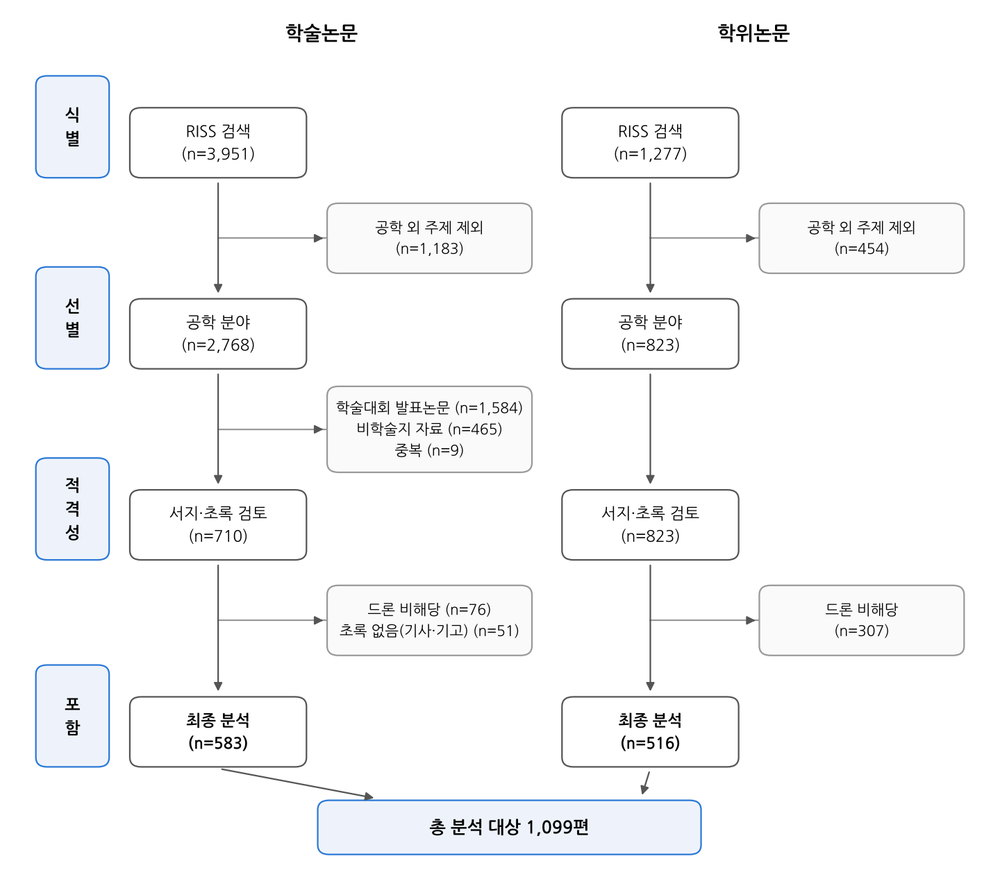
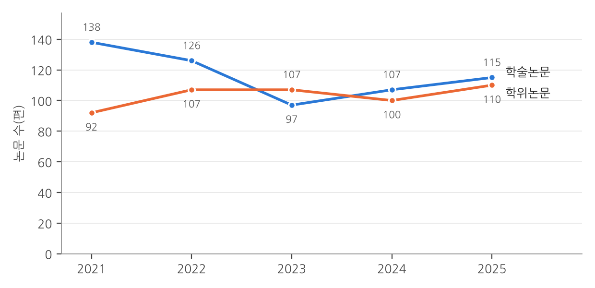
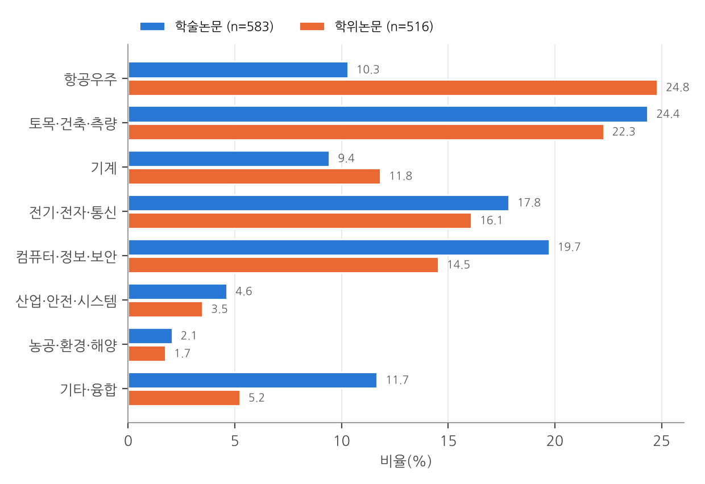
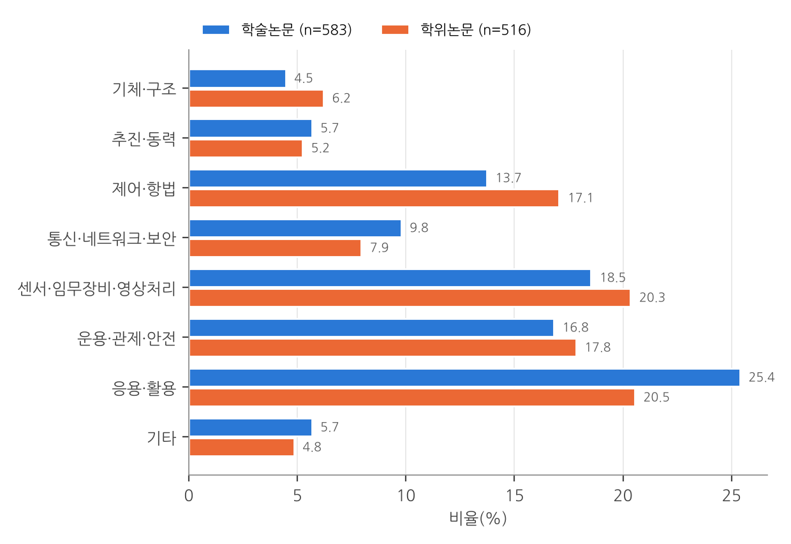
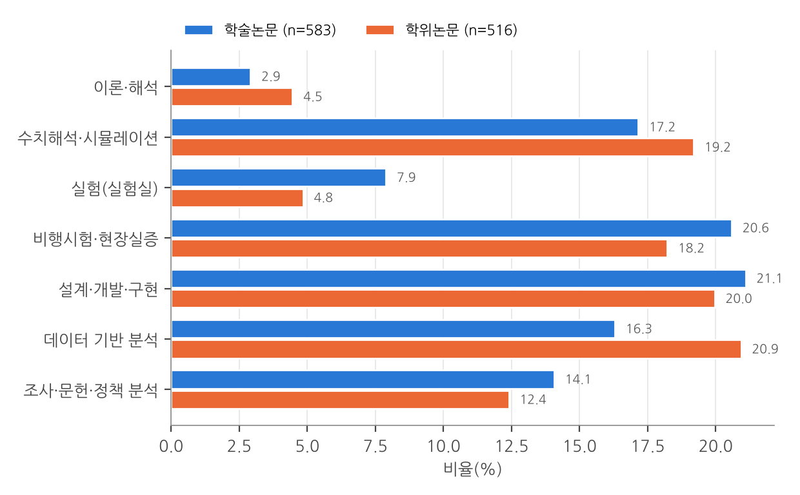

# 드론공학의 연구동향과 연구방법론 고찰

**A Review of Research Trends and Methodologies in Drone Engineering**

---

## 국문초록

드론은 항공, 기계, 전기·전자, 통신, 제어, 기상, 법·제도 등 여러 학문 영역이 결합된 융합 기술로, 농업·물류·건설·안전점검·재난대응·국방 등 다양한 산업 분야에서 활용 범위가 확대되고 있다. 그러나 국내 드론 산업의 본격적 도입은 2010년대 후반 이후로 역사가 짧고, 기존 연구동향 분석은 개별 응용 분야에 한정되어 공학 전반의 연구 분야와 연구방법을 종합적으로 정리한 연구는 부족하다. 본 연구는 학술연구정보서비스(RISS)에 수록된 최근 5년간(2021~2025년)의 공학 분야 드론 연구를 대상으로 체계적 문헌고찰을 실시하였다. PRISMA 절차에 따라 학술지 논문 583편과 석·박사 학위논문 516편(석사 398편, 박사 118편)을 최종 분석 대상으로 선정하고, 학술논문과 학위논문을 구분하여 연도별, 분야별, 연구대상별, 연구방법별 동향을 분석하였다. 분석 결과, 학위논문은 연평균 103편 수준으로 꾸준히 발표된 반면 학술지 논문은 2021년 138편에서 2023년 97편으로 감소한 후 2025년 115편으로 회복되었다. 학문 분야는 학술논문에서 토목·건축·측량(24.4%), 학위논문에서 항공우주(24.8%)의 비중이 가장 높았다. 연구대상은 두 유형 모두 응용·활용, 센서·임무장비·영상처리, 운용·관제·안전 순으로 많았으며, 기체·구조와 추진·동력 등 플랫폼 핵심 기술 연구는 각각 4.5~6.2%에 그쳤다. 주 연구방법은 학술논문에서 설계·개발·구현(21.1%)과 비행시험·현장실증(20.6%), 학위논문에서 데이터 기반 분석(20.9%)과 설계·개발·구현(20.0%)이 많았다. 연구대상에 따라 연구방법은 뚜렷하게 달랐는데(p < .001), 기체·구조와 제어·항법은 수치해석·시뮬레이션, 추진·동력은 실험실 시험, 센서·영상처리는 데이터 기반 분석, 응용·활용은 비행시험·현장실증이 주된 방법이었다. 검증 수준은 실외 비행시험(27.7%)과 시뮬레이션(30.1%)이 중심이었고 실제 운용 환경에서의 현장 실증은 7.0%에 불과하였다. 본 연구의 결과는 드론 분야 연구자가 자신의 연구 영역에 대한 선행연구 동향을 파악하고 적합한 연구방법을 선택하는 데 기초자료로 활용될 수 있다.

**주제어:** 드론, 무인비행장치, 드론공학, 연구동향, 연구방법론, 체계적 문헌고찰

---

## Ⅰ. 서론

### 1. 연구의 배경

드론(drone)은 조종사가 탑승하지 않은 상태에서 원격조종 또는 자율비행이 가능한 비행체를 말하며, 「항공안전법」상 무인비행장치 및 무인항공기를 포괄한다. 군사용으로 개발된 드론은 비행제어 기술, 배터리, 경량 소재, 위성항법, 영상 센서 기술의 발전과 함께 민간 영역으로 빠르게 확산되었다.

국내 드론에 대한 관심과 수요는 기체 신고 및 조종자격 취득 현황에서 확인된다. 드론 조종자격 취득자는 2015년 872명에서 2019년 8월 25,740명으로 증가하였고, 같은 기간 신고된 드론은 925대에서 10,021대로 10배 이상 늘었다(한국경제, 2019). 드론정보포털의 통계에 따르면 누적 기체 신고대수는 2017년 6,044대, 2021년 31,314대, 2024년 64,863대로 7년간 약 10.7배 증가하였다(국토교통부 드론정보포털, 2025). 누적 조종자격 취득자는 13만 8천여 명에 이른다(드론매거진, 【보도연도 확인】).

산업 규모 측면에서 2021년 기준 국내 드론 시장 규모는 약 8,406억 원, 관련 업체 수는 4,994개로 집계되었다(머니투데이, 2024). 세계 시장 역시 성장세를 보이고 있다. 시장조사기관에 따라 추정치의 범위는 상이하나, 2024년 세계 드론 시장은 약 300억 달러 규모로 추정되며, 2029~2030년에는 530억~610억 달러 수준으로 성장할 것으로 전망된다(BCC Research, 2024; TechSci Research, 2024). 정부는 제2차 드론산업발전 기본계획(2023~2032)을 수립하여 세계 드론 산업 규모가 32조 원에서 146조 원으로 확대될 것으로 전망하고, 기술 경쟁력 확보와 시장 창출을 정책 목표로 제시하였다(국토교통부, 2023).

드론의 활용 분야는 농업(방제, 파종, 작황 관측), 물류(도서·산간 배송), 건설·국토(측량, 3차원 모델링, 지적재조사), 시설물 안전점검(교량, 송전선, 태양광 설비), 재난·안전(수색, 산불 감시, 해양 오염 관측), 환경·기상 관측, 공공행정, 국방, 레저·스포츠 등으로 확대되고 있다. 인천광역시는 드론·위성·소나를 결합한 해양 쓰레기 관측 체계를 운영하고 있으며(보안뉴스, 2025), 통영시는 배송센터 3곳을 거점으로 15개 섬마을에 드론 배송을 실시하고 있다(뉴시스, 2025). 드론은 인력 접근이 어렵거나 위험한 작업을 대체하고, 작업 시간과 비용을 절감하며, 정량적 데이터를 신속하게 확보할 수 있다는 점에서 산업 현장의 효율성과 효과성을 높이는 도구로 평가된다.

### 2. 연구의 필요성

드론 분야에서는 산업 현장을 기반으로 한 실증 연구의 수요가 크다. 국토교통부는 2025년 드론실증도시 구축사업에 130억 원을 편성하여 드론배송, 드론레저스포츠, 첨단드론행정서비스 분야를 지원하였으며, 47개 지자체와 39개 기업이 응모하여 26개 지자체와 7개 기업이 선정되었다(국토교통부, 2025a). 2024년 시범 운영에서는 14개 지자체, 50개 지역(섬 32곳, 공원 17곳, 항만 1곳)에서 총 2,993회, 10,635km의 드론 배송이 실시되었다(국토교통부, 2025a). 2026년에는 드론실증도시 30개 지자체와 드론 상용화 지원 19개 기업·컨소시엄이 선정되어 실증 규모가 확대되었다(국토교통부, 2026). 또한 드론특별자유화구역은 2025년 7월 기준 32개 지자체, 67개 구역으로 확대되어 규제 특례 하에서 실증 연구를 수행할 수 있는 공간이 늘어났다(국토교통부, 2025b).

반면 기술 기반은 아직 취약하다. 2024년 드론산업 실태조사에 따르면 드론 제작업체의 부품별 국산화율은 동체 72.6%, 통신모듈 50.3%, 비행제어컴퓨터 37.5%, 배터리 3.8%로, 비행제어·동력계 등 핵심 부품의 국산화 수준이 낮다(보안뉴스, 2025). 이는 기체 설계, 추진·동력, 제어·항법, 통신 등 공학 분야 연구의 축적이 필요함을 의미한다.

드론 연구는 여러 학문 영역에 분산되어 수행되고 있다. RISS에서 '드론'을 검색어로 2021~2025년에 발표된 국내 학술논문과 학위논문을 주제 분류별로 집계한 결과는 <표 Ⅰ-1>과 같다. 검색된 문헌은 학술논문 3,951건, 학위논문 1,277건으로 총 5,228건이며, 주제 분류별 합계(복수 분류 포함) 5,508건 중 공학 분야가 3,591건(65.2%)으로 가장 많고, 사회과학 823건(14.9%), 농수해양 248건(4.5%), 자연과학 191건(3.5%) 순이었으며, 예술체육, 교육, 인문학, 의약학 분야에서도 연구가 이루어지고 있다. 연도별로는 학술논문이 2021년 704건에서 2025년 960건으로, 학위논문이 222건에서 311건으로 각각 36.4%, 40.1% 증가하였다.

**표 Ⅰ-1. RISS 주제 분류별 드론 관련 연구 현황(2021~2025)**

| 주제 분류 | 학술논문 | 석사 학위논문 | 박사 학위논문 | 계 | 비율(%) |
|---|---:|---:|---:|---:|---:|
| 공학 | 2,768 | 599 | 224 | 3,591 | 65.2 |
| 자연과학 | 169 | 13 | 9 | 191 | 3.5 |
| 사회과학 | 616 | 144 | 63 | 823 | 14.9 |
| 농수해양 | 213 | 23 | 12 | 248 | 4.5 |
| 의약학 | 1 | 8 | 2 | 11 | 0.2 |
| 인문학 | 26 | 6 | 7 | 39 | 0.7 |
| 예술체육 | 55 | 38 | 22 | 115 | 2.1 |
| 교육 | 34 | 16 | 6 | 56 | 1.0 |
| 복합학 | 154 | 6 | 5 | 165 | 3.0 |
| 기타 | 153 | 100 | 16 | 269 | 4.9 |
| 계 | 4,189 | 953 | 366 | 5,508 | 100.0 |

※ 검색일: 2026. 11. 20., 검색어: 드론, 검색 범위: RISS 국내학술논문 및 학위논문 전체 필드. 학술논문에는 학술대회 발표논문과 학회 기고문이 포함됨. 하나의 문헌이 복수의 주제로 분류될 수 있어 주제 분류별 합계는 전체 문헌 수(학술논문 3,951건, 석사 927건, 박사 350건)보다 큼

이처럼 연구가 여러 분야에 분산되어 있어 연구자가 자신의 분야와 관련된 선행연구의 흐름과 연구방법을 파악하기 어렵다. 국외에서는 Web of Science와 Scopus를 기반으로 한 계량서지학적 분석이 다수 수행되었다. 두 데이터베이스를 통합하여 중복을 제거한 129,124건의 무인항공기 관련 문헌을 분석한 연구(Applied Sciences, 2025), 2015~2024년 드론 배송 연구 1,438편을 분석한 연구(Acta Informatica Pragensia, 2026) 등이 대표적이다. 국내에서도 건설산업 분야 드론 연구 283편에 대한 키워드 분석(2021), 국내외 드론스포츠 연구 72편의 동향 분석(한국스포츠학회지, 2025), 소방 분야 드론 활용 연구 경향 분석(한국산학기술학회, 2021), 안티드론 연구동향 분석(2024) 등이 수행되었다. 그러나 이들 연구는 특정 응용 분야에 한정되어 있거나 연구 주제의 분류에 초점을 두고 있어, 공학적 관점에서 드론 연구 전반의 분야 구성과 연구방법을 체계적으로 정리한 연구는 찾아보기 어렵다.

### 3. 연구의 목적 및 범위

본 연구의 목적은 최근 5년간 국내 드론 공학 연구의 동향을 파악하고, 공학적 관점에서 수행된 연구방법을 체계적으로 정리하는 데 있다. 학술논문과 학위논문은 연구의 목적, 분량, 심사 방식이 다르므로 두 유형을 구분하여 분석한다. 구체적인 연구 문제는 다음과 같다.

- 연구문제 1. 학술논문과 학위논문에서 드론 공학 연구의 연도별 동향은 어떠한가?
- 연구문제 2. 학술논문과 학위논문에서 드론 공학 연구의 분야(학문 분야, 응용 분야)별 동향은 어떠한가?
- 연구문제 3. 학술논문과 학위논문에서 드론 공학 연구의 연구대상(기술 요소)별 동향은 어떠한가?
- 연구문제 4. 학술논문과 학위논문에서 드론 공학 연구의 연구방법과 검증 수준은 어떠하며, 연구대상 및 학문 분야에 따라 어떠한 차이를 보이는가?
- 연구문제 5. 학술논문과 학위논문의 연구동향은 어떠한 차이를 보이는가?

연구의 시간적 범위는 2021년 1월부터 2025년 12월까지로 하며, 내용적 범위는 RISS에 수록된 국내 학술지 논문과 석·박사 학위논문 중 주제 분류가 공학인 논문으로 한정한다.

---

## Ⅱ. 이론적 배경

### 1. 드론의 정의와 분류

「항공안전법」은 사람이 탑승하지 않는 비행체 중 연료 제외 자체중량 150kg 이하인 것을 무인비행장치로, 150kg을 초과하는 것을 무인항공기로 구분한다. 「드론 활용의 촉진 및 기반조성에 관한 법률」(드론법, 2020년 시행)은 조종자가 탑승하지 않은 상태로 항행할 수 있는 비행체를 드론으로 정의한다. 무인비행장치는 최대이륙중량에 따라 1종(25kg 초과 150kg 이하), 2종(7kg 초과 25kg 이하), 3종(2kg 초과 7kg 이하), 4종(250g 초과 2kg 이하)으로 구분되며, 최대이륙중량 2kg 초과 기체와 모든 사업용 기체는 신고 대상이다.

드론은 형상에 따라 고정익, 회전익(멀티콥터, 헬리콥터형), 수직이착륙 복합형(틸트로터, 리프트-크루즈), 기타(날갯짓형 등)로 구분되며, 운용 방식에 따라 가시권(VLOS)과 비가시권(BVLOS) 운용으로 나뉜다. 최근에는 드론 기술을 기반으로 한 도심항공교통(UAM)이 등장하여 유·무인 전기 수직이착륙기(eVTOL)까지 드론 연구의 범위가 확장되고 있다.

### 2. 드론공학의 기술 영역

드론공학은 드론의 설계, 제작, 운용, 활용에 필요한 공학 지식의 체계로, <표 Ⅱ-1>과 같이 7개 기술 영역으로 구분할 수 있다. 본 연구에서는 이를 연구대상의 분류 기준으로 사용한다.

**표 Ⅱ-1. 드론공학의 기술 영역(연구대상 분류 기준)**

| 기술 영역 | 주요 연구 내용 | 관련 학문 분야 |
|---|---|---|
| 기체·구조 | 기체·형상 설계, 공력, 구조해석, 복합재, 진동·소음, 랜딩기어 | 항공우주공학, 기계공학, 재료공학 |
| 추진·동력 | 모터·프로펠러·로터, 배터리·연료전지·하이브리드 동력, 전력·충전, 열관리 | 기계공학, 전기공학, 화학공학 |
| 제어·항법 | 자세·위치 제어, 경로계획, GNSS/INS/VIO/SLAM 항법, 충돌회피, 자율비행, 군집·편대비행 | 제어공학, 전자공학, 컴퓨터공학 |
| 통신·네트워크·보안 | 통신 링크, 이동통신·중계, 엣지컴퓨팅, 사이버보안·포렌식, 암호·인증 | 전자·통신공학, 정보보호 |
| 센서·임무장비·영상처리 | 카메라·LiDAR·열화상·분광 센서, 임무장비·매니퓰레이터, 영상처리·객체탐지 | 전자공학, 원격탐사, 컴퓨터비전 |
| 운용·관제·안전 | UTM·공역·관제, 운용 체계·임무할당, 안전성·위험도 평가, 불법드론 탐지·대응(안티드론), 인증·감항 | 항공교통, 안전공학, 산업공학 |
| 응용·활용 | 드론을 도구로 활용하여 측량, 작황, 시설물 상태, 환경 관측 등 특정 분야의 문제를 해결하는 연구 | 토목·측량, 농공학, 환경공학 등 |

### 3. 공학 연구방법의 유형

공학 연구에서 적용되는 연구방법은 지식 생산의 방식에 따라 이론·해석적 방법, 수치해석·시뮬레이션, 실험, 실증·현장시험, 설계·개발, 데이터 기반 분석으로 구분할 수 있다. 드론 연구의 특성을 반영하여 본 연구에서 적용한 연구방법 분류는 <표 Ⅱ-2>와 같다. 또한 연구 결과가 어느 단계에서 검증되었는지를 파악하기 위해 검증 수준을 이론, 시뮬레이션, 실험실·지상시험, 실외 비행시험, 현장 실증의 5단계로 구분하였다.

**표 Ⅱ-2. 드론공학 연구방법 분류 기준**

| 연구방법 | 내용 및 예시 |
|---|---|
| 이론·해석 | 수학적 모델링, 해석해 도출, 안정성 증명, 최적화 문제 정식화 |
| 수치해석·시뮬레이션 | 전산유체역학(CFD), 유한요소해석(FEM), 비행 시뮬레이션(MATLAB/Simulink, Gazebo, SITL 등), 네트워크 시뮬레이션 |
| 실험(실험실) | 지상 시험대, 추력시험, 풍동시험, HILS, 실내 실험, 성능 측정 |
| 비행시험·현장실증 | 실기체 실외 비행시험, 현장 적용·실증, 대상지에서 드론으로 데이터를 취득하여 분석 |
| 설계·개발·구현 | 시스템·하드웨어·소프트웨어의 설계·개발·구현이 주된 기여인 연구 |
| 데이터 기반 분석 | 기계학습·딥러닝 모델의 학습·평가, 영상·점군 데이터 처리, 통계 분석 |
| 조사·문헌·정책 분석 | 설문, 델파이·AHP, 전문가 조사, 문헌·사례·정책·법제 분석 |

### 4. 선행연구 검토

드론 연구동향에 관한 국내 선행연구는 주로 특정 응용 분야를 중심으로 수행되었다. 건설산업 분야에서는 2011~2020년에 발표된 논문 283편을 대상으로 Gephi를 활용한 키워드 연결중심성 분석이 수행되었다(2021). 드론스포츠 분야에서는 KCI 등재지와 학위논문, SCI·Scopus 논문 72편을 분석하여 국내 연구가 교육적 활용에 집중된 반면 국외 연구는 기술 실험과 상업적 활용에 중점을 둔다는 결과를 제시하였다(한국스포츠학회지, 2025). 이 밖에 소방 분야 드론 활용 연구 경향 분석(한국산학기술학회, 2021), 안티드론 연구동향 분석(2024), 공공분야 드론 활용방안 연구 등이 있다.

국외 연구로는 Web of Science와 Scopus를 통합한 대규모 계량서지 분석(Applied Sciences, 2025), 2024년까지의 UAV 원격탐사 연구 4,985편 분석(MDPI, 2025), 드론 배송 연구 1,438편 분석(Acta Informatica Pragensia, 2026) 등이 있다. 군용 무인전투기 연구를 분석한 계량서지 연구에서는 분석 대상 연구가 모두 기술·공학 분야에 집중되어 있어 사회과학과의 융합 연구가 제한적인 것으로 나타났다.

선행연구는 분석 대상이 특정 응용 분야에 한정되어 있고, 연구 주제나 키워드 분포에 초점을 두고 있어 연구방법에 대한 체계적 분류가 이루어지지 않았다는 한계가 있다. 본 연구는 공학 분야 전반을 대상으로 학술논문과 학위논문을 구분하여 연구 분야, 연구대상, 연구방법을 통합적으로 분석한다는 점에서 선행연구와 차별성을 가진다.

**표 Ⅱ-3. 드론 연구동향 관련 선행연구**

| 연구자(연도) | 분석 대상 | 분석 자료 | 분석 방법 | 주요 결과 |
|---|---|---|---|---|
| 【저자】(2021) | 건설산업 드론 연구 | 283편(2011~2020) | 키워드 연결중심성 분석 | 【입력】 |
| 【저자】(2021) | 소방 분야 드론 활용 | 【입력】 | 연구 경향 분석 | 【입력】 |
| 【저자】(2024) | 안티드론 연구 | 【입력】 | 연구동향 분석 | 【입력】 |
| 【저자】(2025) | 드론스포츠 연구 | 72편(국내외) | 주제 범주 분류 | 국내: 교육적 활용 중심, 국외: 기술·상업 활용 중심 |
| 【저자】(2025) | UAV 연구 전반 | WoS·Scopus 129,124건 | 계량서지 분석 | 【입력】 |

---

## Ⅲ. 연구방법

### 1. 연구 설계

본 연구는 체계적 문헌고찰(systematic literature review) 방법을 적용하였으며, 문헌 선정 절차는 PRISMA 2020 지침에 따랐다. 자료 분석에는 내용분석(content analysis), 빈도·교차분석, 키워드 네트워크 분석을 병행하였다.

### 2. 자료 수집

자료는 학술연구정보서비스(RISS)의 국내학술논문과 학위논문 데이터베이스에서 수집하였다. RISS는 KCI 등재·등재후보 학술지와 국내 대학의 석·박사 학위논문을 포괄하여 국내 연구 성과를 폭넓게 확인할 수 있다. 검색 조건은 다음과 같다.

- 검색일: 2026년 11월 20일
- 검색어: 드론(전체 필드)
- 발행연도: 2021년 ~ 2025년
- 주제 분류: 공학

검색된 각 문헌에 대해 제목, 저자, 발행연도, 학술지명 또는 학위수여기관·학과, 학위 유형, 주제어, 초록을 수집하였다.

### 3. 분석 대상 선정

**1) 포함 기준**

- 항공 드론(무인비행장치, 무인항공기, 멀티콥터, UAM·eVTOL 등)이 연구의 주된 대상이거나 데이터 취득 등 핵심 연구 도구인 논문
- 동료심사를 거치는 학술지에 게재된 논문 또는 석·박사 학위논문

**2) 제외 기준**

- 학술대회 발표논문 및 초록, 학회 소식지·잡지·보고서 등 비학술지 자료
- 초록이 없는 기사·기고 형식의 자료
- 드론을 단순 언급하는 데 그치거나 드론과 무관한 논문
- 수중 드론, 해상 무인선 등 항공 드론이 아닌 무인이동체 연구
- 중복 수록 논문

**3) 선정 절차**

검색 결과 학술논문 3,951편, 학위논문 1,277편이 식별되었다. 주제 분류가 공학이 아닌 학술논문 1,183편과 학위논문 454편을 제외하였다. 학술논문 2,768편 중 학술대회 발표논문 1,584편, 비학술지 자료 465편, 중복 9편을 제외하여 710편을 선별하였다. 선별된 학술논문 710편과 학위논문 823편의 서지정보, 주제어, 초록을 검토하여 드론이 연구의 주제 또는 핵심 도구가 아닌 학술논문 76편과 학위논문 307편, 초록이 없는 기사·기고 형식의 학술논문 51편을 제외하였다. 최종 분석 대상은 학술논문 583편, 학위논문 516편으로 총 1,099편이다. 제목 또는 주제어에 항공 드론 관련 용어(드론, 무인기, UAV, UAM, eVTOL, 버티포트 등)가 포함된 논문은 포함하고, 수중·수상 무인이동체 관련 논문은 제외하는 규칙을 일관되게 적용하였다.

**그림 Ⅲ-1. 분석 대상 문헌 선정 절차(PRISMA 흐름도)**

### 4. 분석 틀 및 코딩

최종 선정된 논문은 <표 Ⅲ-1>의 분석 틀에 따라 코딩하였다. 학문 분야는 학술논문의 경우 게재 학술지의 분야를, 학위논문의 경우 학위수여 학과를 기준으로 분류하였다. 연구대상, 응용 분야, 연구방법, 검증 수준은 제목, 주제어, 초록을 근거로 사전에 정의한 코딩북에 따라 분류하였다. 연구대상과 연구방법은 논문의 주된 기여에 해당하는 항목 1개(주 항목)와 해당하는 모든 항목(복수 항목)을 함께 코딩하였다. 코딩 신뢰도를 확인하기 위해 분석 대상 중 무작위로 추출한 110편(10%)을 연구자 2인이 독립적으로 재코딩하여 평가자 간 일치도(Cohen's κ)를 산출하였다(κ = 【 】).

**표 Ⅲ-1. 분석 틀**

| 분석 항목 | 분석 내용 | 분류 기준 |
|---|---|---|
| 연도 | 발행연도 | 2021~2025 |
| 논문 유형 | 학술지 논문, 학위논문(석사·박사) | RISS 자료 유형, 학위 유형 |
| 학문 분야 | 연구가 수행된 공학 세부 분야 | 항공우주, 토목·건축·측량, 기계, 전기·전자·통신, 컴퓨터·정보·보안, 산업·안전·시스템, 농공·환경·해양, 기타·융합 |
| 응용 분야 | 드론이 활용되는 산업 분야 | 농업·산림, 물류·배송, 건설·측량·국토, 시설물 점검·유지관리, 재난·안전·소방, 환경·기상·해양, 국방·보안, 교통·도심항공, 기타 응용, 범용 |
| 연구대상 | 연구의 주된 기술 요소 | <표 Ⅱ-1>의 7개 영역 및 기타 |
| 연구방법 | 결과 도출과 검증에 적용된 방법 | <표 Ⅱ-2>의 7개 유형 |
| 검증 수준 | 연구 결과가 검증된 가장 높은 단계 | 이론, 시뮬레이션, 실험실·지상시험, 실외 비행시험, 현장 실증, 해당 없음(조사·정책) |
| 키워드 | 연구 내용을 대표하는 핵심어 | 주제어를 표준 용어로 정규화(논문당 3~5개) |

### 5. 분석 방법

첫째, 학술논문과 학위논문 각각에 대해 연도, 학문 분야, 응용 분야, 연구대상, 연구방법, 검증 수준의 빈도와 비율을 산출하였다. 둘째, 연도와 연구대상·연구방법, 학문 분야와 연구대상·연구방법, 연구대상과 연구방법 간의 관계를 교차분석으로 확인하고 χ² 검정을 실시하였다. 셋째, 정규화한 키워드의 동시출현 관계로 네트워크를 구성하여 연결중심성과 매개중심성을 산출하고, 분석 기간을 전기(2021~2023)와 후기(2024~2025)로 구분하여 상위 키워드를 비교하였다. 넷째, 학술논문과 학위논문 간 연구대상, 연구방법, 검증 수준, 응용 분야의 분포 차이를 χ² 검정으로 비교하였다. 분석에는 Python(pandas, SciPy, NetworkX)을 사용하였다.

---

## Ⅳ. 연구결과

### 1. 학술논문 분석

#### 1) 연도별 동향

분석 대상 학술논문 583편의 연도별 분포는 <표 Ⅳ-1>과 같다. 2021년 138편(23.7%)으로 가장 많았고, 2022년 126편, 2023년 97편으로 감소한 후 2024년 107편, 2025년 115편으로 다시 증가하였다. RISS 전체 검색 결과에서는 드론 관련 학술논문이 매년 증가하였으나, 학술대회 발표논문과 기고문을 제외한 학술지 논문은 2023년을 저점으로 회복세를 보였다. 이는 드론 분야의 연구 성과가 학술대회 발표 형태로 활발히 공유되는 반면, 심사를 거친 학술지 논문으로 발전하는 비율은 상대적으로 낮음을 시사한다.

**표 Ⅳ-1. 학술논문의 연도별 분포**

| 구분 | 2021 | 2022 | 2023 | 2024 | 2025 | 계 |
|---|---:|---:|---:|---:|---:|---:|
| 논문 수 | 138 | 126 | 97 | 107 | 115 | 583 |
| 비율(%) | 23.7 | 21.6 | 16.6 | 18.4 | 19.7 | 100.0 |

게재 학술지는 총 128종이었으며, 상위 10개 학술지는 <표 Ⅳ-2>와 같다. 한국산학기술학회논문지(46편)와 한국측량학회지(38편)에 가장 많이 게재되었고, 정보통신·전자통신·항행·항공우주 분야 학술지가 뒤를 이었다.

**표 Ⅳ-2. 학술논문의 주요 게재 학술지(상위 10개)**

| 순위 | 학술지 | 편수 |
|---:|---|---:|
| 1 | 한국산학기술학회논문지 | 46 |
| 2 | 한국측량학회지 | 38 |
| 3 | 한국전자통신학회 논문지 | 19 |
| 4 | 한국정보통신학회논문지 | 19 |
| 5 | 한국항행학회논문지 | 19 |
| 6 | 한국통신학회논문지 | 17 |
| 7 | 한국정보기술학회논문지 | 15 |
| 8 | 항공우주시스템공학회지 | 15 |
| 9 | 한국항공우주학회지 | 13 |
| 10 | 한국전자파학회 논문지 | 13 |

#### 2) 분야별 동향

학문 분야별로는 토목·건축·측량이 142편(24.4%)으로 가장 많았고, 컴퓨터·정보·보안 115편(19.7%), 전기·전자·통신 104편(17.8%), 기타·융합 68편(11.7%), 항공우주 60편(10.3%), 기계 55편(9.4%) 순이었다(<표 Ⅳ-3>). 드론 기체를 직접 다루는 항공우주와 기계 분야보다, 드론을 측량·영상 취득 도구로 활용하는 토목·측량 분야와 소프트웨어·통신을 다루는 정보통신 분야의 비중이 높았다.

**표 Ⅳ-3. 학술논문의 학문 분야별 분포**

| 구분 | 빈도 | 비율(%) |
|---|---:|---:|
| 항공우주 | 60 | 10.3 |
| 토목·건축·측량 | 142 | 24.4 |
| 기계 | 55 | 9.4 |
| 전기·전자·통신 | 104 | 17.8 |
| 컴퓨터·정보·보안 | 115 | 19.7 |
| 산업·안전·시스템 | 27 | 4.6 |
| 농공·환경·해양 | 12 | 2.1 |
| 기타·융합 | 68 | 11.7 |
| 계 | 583 | 100.0 |

응용 분야별로는 특정 응용 분야를 상정하지 않은 범용 연구가 154편(26.4%)으로 가장 많았다. 특정 분야 중에서는 국방·보안 90편(15.4%), 건설·측량·국토 77편(13.2%), 시설물 점검·유지관리 62편(10.6%), 재난·안전·소방 47편(8.1%) 순이었으며, 물류·배송은 19편(3.3%)으로 가장 적었다(<표 Ⅳ-4>). 다만 물류·배송 연구는 2021~2023년 7편에서 2024~2025년 12편으로 증가하였고, 국방·보안 연구는 2024년에 27편으로 가장 많아 안티드론 등 국방 수요가 반영된 것으로 보인다.

**표 Ⅳ-4. 학술논문의 응용 분야별 분포**

| 구분 | 빈도 | 비율(%) |
|---|---:|---:|
| 농업·산림 | 34 | 5.8 |
| 물류·배송 | 19 | 3.3 |
| 건설·측량·국토 | 77 | 13.2 |
| 시설물 점검·유지관리 | 62 | 10.6 |
| 재난·안전·소방 | 47 | 8.1 |
| 환경·기상·해양 | 37 | 6.3 |
| 국방·보안 | 90 | 15.4 |
| 교통·도심항공 | 29 | 5.0 |
| 기타 응용 | 34 | 5.8 |
| 범용(특정분야 없음) | 154 | 26.4 |
| 계 | 583 | 100.0 |

#### 3) 연구대상별 동향

주 연구대상은 응용·활용이 148편(25.4%)으로 가장 많았고, 센서·임무장비·영상처리 108편(18.5%), 운용·관제·안전 98편(16.8%), 제어·항법 80편(13.7%), 통신·네트워크·보안 57편(9.8%) 순이었다. 드론 플랫폼의 핵심 기술인 추진·동력(33편, 5.7%)과 기체·구조(26편, 4.5%)는 가장 적었다(<표 Ⅳ-5>). 복수 코딩 기준으로는 센서·임무장비·영상처리가 246편(42.2%)에서 다루어져, 영상 취득과 처리가 드론 연구 전반에 걸친 공통 요소임을 확인할 수 있다(<표 Ⅳ-6>).

**표 Ⅳ-5. 학술논문의 연구대상(주 기술요소)별 분포**

| 구분 | 빈도 | 비율(%) |
|---|---:|---:|
| 기체·구조 | 26 | 4.5 |
| 추진·동력 | 33 | 5.7 |
| 제어·항법 | 80 | 13.7 |
| 통신·네트워크·보안 | 57 | 9.8 |
| 센서·임무장비·영상처리 | 108 | 18.5 |
| 운용·관제·안전 | 98 | 16.8 |
| 응용·활용 | 148 | 25.4 |
| 기타 | 33 | 5.7 |
| 계 | 583 | 100.0 |

**표 Ⅳ-6. 학술논문의 연구대상(복수 기술요소) 분포**

| 구분 | 빈도 | 비율(%) |
|---|---:|---:|
| 기체·구조 | 50 | 8.6 |
| 추진·동력 | 50 | 8.6 |
| 제어·항법 | 130 | 22.3 |
| 통신·네트워크·보안 | 81 | 13.9 |
| 센서·임무장비·영상처리 | 246 | 42.2 |
| 운용·관제·안전 | 151 | 25.9 |
| 응용·활용 | 203 | 34.8 |
| 기타 | 40 | 6.9 |
| 계 | 951 | - |

※ 복수 코딩, 비율은 분석 대상 논문 수(n=583) 대비

학문 분야와 연구대상의 교차분석 결과, 두 변수 간에는 유의한 관련이 있었다(<표 Ⅳ-7>). 토목·건축·측량 분야는 응용·활용(65.5%)에 집중되었고, 항공우주 분야는 제어·항법(26.7%)과 운용·관제·안전(23.3%), 기계 분야는 제어·항법(27.3%)과 추진·동력(20.0%), 컴퓨터·정보·보안 분야는 통신·네트워크·보안(25.2%)과 운용·관제·안전(22.6%)의 비중이 높았다.

**표 Ⅳ-7. 학술논문의 학문 분야 × 연구대상**

| 구분 | 기체·구조 | 추진·동력 | 제어·항법 | 통신·네트워크·보안 | 센서·임무장비·영상처리 | 운용·관제·안전 | 응용·활용 | 기타 | 계 |
|---|---:|---:|---:|---:|---:|---:|---:|---:|---:|
| 항공우주 | 8 (13.3) | 6 (10.0) | 16 (26.7) | 5 (8.3) | 8 (13.3) | 14 (23.3) | 3 (5.0) | 0 (0.0) | 60 |
| 토목·건축·측량 | 2 (1.4) | 2 (1.4) | 4 (2.8) | 1 (0.7) | 30 (21.1) | 8 (5.6) | 93 (65.5) | 2 (1.4) | 142 |
| 기계 | 9 (16.4) | 11 (20.0) | 15 (27.3) | 0 (0.0) | 9 (16.4) | 7 (12.7) | 1 (1.8) | 3 (5.5) | 55 |
| 전기·전자·통신 | 2 (1.9) | 9 (8.7) | 21 (20.2) | 17 (16.3) | 24 (23.1) | 20 (19.2) | 9 (8.7) | 2 (1.9) | 104 |
| 컴퓨터·정보·보안 | 1 (0.9) | 4 (3.5) | 18 (15.7) | 29 (25.2) | 20 (17.4) | 26 (22.6) | 6 (5.2) | 11 (9.6) | 115 |
| 산업·안전·시스템 | 2 (7.4) | 0 (0.0) | 2 (7.4) | 2 (7.4) | 2 (7.4) | 10 (37.0) | 6 (22.2) | 3 (11.1) | 27 |
| 농공·환경·해양 | 1 (8.3) | 0 (0.0) | 0 (0.0) | 0 (0.0) | 0 (0.0) | 0 (0.0) | 10 (83.3) | 1 (8.3) | 12 |
| 기타·융합 | 1 (1.5) | 1 (1.5) | 4 (5.9) | 3 (4.4) | 15 (22.1) | 13 (19.1) | 20 (29.4) | 11 (16.2) | 68 |
| 계 | 26 | 33 | 80 | 57 | 108 | 98 | 148 | 33 | 583 |

※ 셀 값: 빈도(행 기준 %)

χ² = 378.91, df = 49, p < .001 (기대빈도 5 미만 셀 37.5%)

#### 4) 연구방법별 동향

주 연구방법은 설계·개발·구현이 123편(21.1%)으로 가장 많았고, 비행시험·현장실증 120편(20.6%), 수치해석·시뮬레이션 100편(17.2%), 데이터 기반 분석 95편(16.3%), 조사·문헌·정책 분석 82편(14.1%), 실험(실험실) 46편(7.9%), 이론·해석 17편(2.9%) 순이었다(<표 Ⅳ-8>). 논문 1편당 평균 1.63개의 연구방법이 적용되었으며, 복수 코딩 기준으로는 비행시험·현장실증(34.8%)과 데이터 기반 분석(31.6%)의 적용 비율이 높았다(<표 Ⅳ-9>).

**표 Ⅳ-8. 학술논문의 주 연구방법별 분포**

| 구분 | 빈도 | 비율(%) |
|---|---:|---:|
| 이론·해석 | 17 | 2.9 |
| 수치해석·시뮬레이션 | 100 | 17.2 |
| 실험(실험실) | 46 | 7.9 |
| 비행시험·현장실증 | 120 | 20.6 |
| 설계·개발·구현 | 123 | 21.1 |
| 데이터 기반 분석 | 95 | 16.3 |
| 조사·문헌·정책 분석 | 82 | 14.1 |
| 계 | 583 | 100.0 |

**표 Ⅳ-9. 학술논문의 적용 연구방법(복수) 분포**

| 구분 | 빈도 | 비율(%) |
|---|---:|---:|
| 이론·해석 | 43 | 7.4 |
| 수치해석·시뮬레이션 | 142 | 24.4 |
| 실험(실험실) | 110 | 18.9 |
| 비행시험·현장실증 | 203 | 34.8 |
| 설계·개발·구현 | 165 | 28.3 |
| 데이터 기반 분석 | 184 | 31.6 |
| 조사·문헌·정책 분석 | 101 | 17.3 |
| 계 | 948 | - |

※ 복수 코딩, 비율은 분석 대상 논문 수(n=583) 대비

검증 수준은 실외 비행시험이 175편(30.0%)으로 가장 많았고, 시뮬레이션 157편(26.9%), 실험실·지상시험 117편(20.1%) 순이었다. 실제 운용 환경이나 시범사업에서 검증한 현장 실증은 37편(6.3%)에 그쳤다(<표 Ⅳ-10>).

**표 Ⅳ-10. 학술논문의 검증 수준별 분포**

| 구분 | 빈도 | 비율(%) |
|---|---:|---:|
| 이론 | 12 | 2.1 |
| 시뮬레이션 | 157 | 26.9 |
| 실험실·지상시험 | 117 | 20.1 |
| 실외 비행시험 | 175 | 30.0 |
| 현장 실증 | 37 | 6.3 |
| 해당 없음(조사·정책) | 85 | 14.6 |
| 계 | 583 | 100.0 |

연도별로는 비행시험·현장실증을 주 방법으로 한 논문이 2021~2023년 연 27~29편에서 2025년 16편으로 감소한 반면, 수치해석·시뮬레이션은 2023년 10편에서 2025년 27편으로 증가하였다(<표 Ⅳ-11>).

**표 Ⅳ-11. 학술논문의 주 연구방법 × 연도**

| 구분 | 2021 | 2022 | 2023 | 2024 | 2025 | 계 |
|---|---:|---:|---:|---:|---:|---:|
| 이론·해석 | 5 (29.4) | 3 (17.6) | 2 (11.8) | 2 (11.8) | 5 (29.4) | 17 |
| 수치해석·시뮬레이션 | 20 (20.0) | 19 (19.0) | 10 (10.0) | 24 (24.0) | 27 (27.0) | 100 |
| 실험(실험실) | 7 (15.2) | 9 (19.6) | 16 (34.8) | 6 (13.0) | 8 (17.4) | 46 |
| 비행시험·현장실증 | 27 (22.5) | 28 (23.3) | 29 (24.2) | 20 (16.7) | 16 (13.3) | 120 |
| 설계·개발·구현 | 36 (29.3) | 32 (26.0) | 17 (13.8) | 13 (10.6) | 25 (20.3) | 123 |
| 데이터 기반 분석 | 19 (20.0) | 18 (18.9) | 13 (13.7) | 23 (24.2) | 22 (23.2) | 95 |
| 조사·문헌·정책 분석 | 24 (29.3) | 17 (20.7) | 10 (12.2) | 19 (23.2) | 12 (14.6) | 82 |
| 계 | 138 | 126 | 97 | 107 | 115 | 583 |

※ 셀 값: 빈도(행 기준 %)

연구대상과 주 연구방법 간에는 뚜렷한 관련이 있었다(<표 Ⅳ-12>). 기체·구조 연구의 61.5%는 수치해석·시뮬레이션을 적용하였고, 추진·동력은 수치해석·시뮬레이션과 실험(각 27.3%), 제어·항법은 수치해석·시뮬레이션과 설계·개발·구현(각 38.8%), 통신·네트워크·보안은 수치해석·시뮬레이션(33.3%)과 실험(29.8%)이 많았다. 센서·임무장비·영상처리는 데이터 기반 분석(43.5%), 운용·관제·안전은 조사·문헌·정책 분석(31.6%), 응용·활용은 비행시험·현장실증(64.9%)이 주된 방법이었다.

**표 Ⅳ-12. 학술논문의 연구대상 × 주 연구방법**

| 구분 | 이론 | 시뮬 | 실험 | 비행·실증 | 설계·개발 | 데이터 | 조사·정책 | 계 |
|---|---:|---:|---:|---:|---:|---:|---:|---:|
| 기체·구조 | 1 (3.8) | 16 (61.5) | 4 (15.4) | 0 (0.0) | 5 (19.2) | 0 (0.0) | 0 (0.0) | 26 |
| 추진·동력 | 1 (3.0) | 9 (27.3) | 9 (27.3) | 0 (0.0) | 8 (24.2) | 2 (6.1) | 4 (12.1) | 33 |
| 제어·항법 | 3 (3.8) | 31 (38.8) | 3 (3.8) | 4 (5.0) | 31 (38.8) | 4 (5.0) | 4 (5.0) | 80 |
| 통신·네트워크·보안 | 2 (3.5) | 19 (33.3) | 17 (29.8) | 5 (8.8) | 10 (17.5) | 1 (1.8) | 3 (5.3) | 57 |
| 센서·임무장비·영상처리 | 0 (0.0) | 7 (6.5) | 7 (6.5) | 13 (12.0) | 34 (31.5) | 47 (43.5) | 0 (0.0) | 108 |
| 운용·관제·안전 | 10 (10.2) | 15 (15.3) | 4 (4.1) | 2 (2.0) | 19 (19.4) | 17 (17.3) | 31 (31.6) | 98 |
| 응용·활용 | 0 (0.0) | 3 (2.0) | 2 (1.4) | 96 (64.9) | 13 (8.8) | 20 (13.5) | 14 (9.5) | 148 |
| 기타 | 0 (0.0) | 0 (0.0) | 0 (0.0) | 0 (0.0) | 3 (9.1) | 4 (12.1) | 26 (78.8) | 33 |
| 계 | 17 | 100 | 46 | 120 | 123 | 95 | 82 | 583 |

※ 셀 값: 빈도(행 기준 %). 이론=이론·해석, 시뮬=수치해석·시뮬레이션, 실험=실험(실험실), 비행·실증=비행시험·현장실증, 설계·개발=설계·개발·구현, 데이터=데이터 기반 분석, 조사·정책=조사·문헌·정책 분석

χ² = 631.79, df = 42, p < .001 (기대빈도 5 미만 셀 30.4%)

학문 분야별로는 토목·건축·측량 분야가 비행시험·현장실증(48.6%)과 데이터 기반 분석(23.9%), 항공우주 분야가 수치해석·시뮬레이션(33.3%)과 설계·개발·구현(25.0%), 기계와 전기·전자·통신 분야가 설계·개발·구현과 수치해석·시뮬레이션을 주로 적용하였다(<표 Ⅳ-13>).

**표 Ⅳ-13. 학술논문의 학문 분야 × 주 연구방법**

| 구분 | 이론 | 시뮬 | 실험 | 비행·실증 | 설계·개발 | 데이터 | 조사·정책 | 계 |
|---|---:|---:|---:|---:|---:|---:|---:|---:|
| 항공우주 | 2 (3.3) | 20 (33.3) | 7 (11.7) | 6 (10.0) | 15 (25.0) | 3 (5.0) | 7 (11.7) | 60 |
| 토목·건축·측량 | 0 (0.0) | 9 (6.3) | 7 (4.9) | 69 (48.6) | 11 (7.7) | 34 (23.9) | 12 (8.5) | 142 |
| 기계 | 2 (3.6) | 15 (27.3) | 7 (12.7) | 1 (1.8) | 17 (30.9) | 7 (12.7) | 6 (10.9) | 55 |
| 전기·전자·통신 | 3 (2.9) | 23 (22.1) | 11 (10.6) | 9 (8.7) | 31 (29.8) | 17 (16.3) | 10 (9.6) | 104 |
| 컴퓨터·정보·보안 | 2 (1.7) | 23 (20.0) | 12 (10.4) | 5 (4.3) | 31 (27.0) | 20 (17.4) | 22 (19.1) | 115 |
| 산업·안전·시스템 | 6 (22.2) | 4 (14.8) | 1 (3.7) | 6 (22.2) | 3 (11.1) | 2 (7.4) | 5 (18.5) | 27 |
| 농공·환경·해양 | 0 (0.0) | 0 (0.0) | 0 (0.0) | 8 (66.7) | 2 (16.7) | 0 (0.0) | 2 (16.7) | 12 |
| 기타·융합 | 2 (2.9) | 6 (8.8) | 1 (1.5) | 16 (23.5) | 13 (19.1) | 12 (17.6) | 18 (26.5) | 68 |
| 계 | 17 | 100 | 46 | 120 | 123 | 95 | 82 | 583 |

※ 셀 값: 빈도(행 기준 %). 이론=이론·해석, 시뮬=수치해석·시뮬레이션, 실험=실험(실험실), 비행·실증=비행시험·현장실증, 설계·개발=설계·개발·구현, 데이터=데이터 기반 분석, 조사·정책=조사·문헌·정책 분석

χ² = 232.41, df = 42, p < .001 (기대빈도 5 미만 셀 35.7%)

#### 5) 주요 키워드

학술논문의 상위 키워드는 딥러닝(32회), 객체탐지(27회), 안티드론(23회), 사진측량(19회), LiDAR(15회), 정사영상(14회) 순이었다(<표 Ⅳ-14>). 딥러닝은 연결중심성(0.054)과 매개중심성(0.175)이 모두 가장 높아, 서로 다른 연구 주제를 연결하는 핵심 기술로 나타났다. 시기별로는 전기에 딥러닝, 사진측량, 정사영상, 공간정보 등 측량·영상 분야 키워드가 상위를 차지하였으나, 후기에는 안티드론, LiDAR, 강화학습, 자율비행, 경로계획, 드론배송이 새롭게 상위에 올랐다(<표 Ⅳ-15>).

**표 Ⅳ-14. 학술논문의 상위 키워드 및 중심성**

| 순위 | 키워드 | 빈도 | 연결중심성 | 매개중심성 |
|---:|---|---:|---:|---:|
| 1 | 딥러닝 | 32 | 0.054 | 0.175 |
| 2 | 객체탐지 | 27 | 0.042 | 0.120 |
| 3 | 안티드론 | 23 | 0.036 | 0.111 |
| 4 | 사진측량 | 19 | 0.036 | 0.064 |
| 5 | LiDAR | 15 | 0.029 | 0.080 |
| 6 | 정사영상 | 14 | 0.026 | 0.052 |
| 7 | 객체인식 | 10 | 0.017 | 0.018 |
| 8 | 강화학습 | 10 | 0.017 | 0.041 |
| 9 | 인공지능 | 9 | 0.016 | 0.031 |
| 10 | 공간정보 | 9 | 0.016 | 0.025 |
| 11 | 시뮬레이션 | 9 | 0.014 | 0.027 |
| 12 | YOLO | 9 | 0.015 | 0.061 |
| 13 | 건설현장 | 8 | 0.013 | 0.024 |
| 14 | 군집비행 | 8 | 0.014 | 0.030 |
| 15 | 열화상 | 8 | 0.014 | 0.022 |

**표 Ⅳ-15. 학술논문의 시기별 상위 키워드**

| 순위 | 전기(2021~2023) | 후기(2024~2025) |
|---:|---|---|
| 1 | 딥러닝 (24) | 안티드론 (12) |
| 2 | 사진측량 (16) | 객체탐지 (12) |
| 3 | 객체탐지 (15) | LiDAR (10) |
| 4 | 정사영상 (11) | 딥러닝 (8) |
| 5 | 안티드론 (11) | 강화학습 (7) |
| 6 | 공간정보 (7) | YOLO (6) |
| 7 | 건설현장 (7) | 자율비행 (5) |
| 8 | 드론스테이션 (7) | 경로계획 (5) |
| 9 | 객체인식 (6) | 드론배송 (5) |
| 10 | 군집비행 (6) | 인공지능 (5) |

### 2. 학위논문 분석

#### 1) 연도별 동향

분석 대상 학위논문 516편 중 석사학위논문은 398편(77.1%), 박사학위논문은 118편(22.9%)이었다. 연도별로는 2021년 92편, 2022년과 2023년 각 107편, 2024년 100편, 2025년 110편으로 연 100편 내외의 수준이 꾸준히 유지되었다(<표 Ⅳ-16>). 박사학위논문은 연 20~29편 수준이었다.

**표 Ⅳ-16. 학위논문의 연도별·학위별 분포**

| 구분 | 2021 | 2022 | 2023 | 2024 | 2025 | 계 | 비율(%) |
|---|---:|---:|---:|---:|---:|---:|---:|
| 석사 | 72 | 78 | 87 | 77 | 84 | 398 | 77.1 |
| 박사 | 20 | 29 | 20 | 23 | 26 | 118 | 22.9 |
| 계 | 92 | 107 | 107 | 100 | 110 | 516 | 100.0 |

**그림 Ⅳ-1. 학술논문과 학위논문의 연도별 추이**

학위수여 학과는 <표 Ⅳ-17>과 같이 항공우주공학과(27편), 기계공학과(20편), 토목공학과(16편), 컴퓨터공학과(15편) 등 전통적 공학 학과와 함께 드론산업공학과(16편), 무인기공학과(12편) 등 드론 특화 학과와 항공안전관리학 전공이 상위에 나타났다.

**표 Ⅳ-17. 학위논문의 주요 학위수여 학과(상위 10개)**

| 순위 | 학과(전공) | 편수 |
|---:|---|---:|
| 1 | 항공우주공학과 | 27 |
| 2 | 기계공학과 | 20 |
| 3 | 드론산업공학과 | 16 |
| 4 | 토목공학과 | 16 |
| 5 | 컴퓨터공학과 | 15 |
| 6 | 무인기공학과 | 12 |
| 7 | 항공안전관리학전공 | 10 |
| 8 | 전기및전자공학부 | 9 |
| 9 | 전기전자공학과 | 8 |
| 10 | 정보통신공학과 | 7 |

#### 2) 분야별 동향

학문 분야별로는 항공우주가 128편(24.8%)으로 가장 많았고, 토목·건축·측량 115편(22.3%), 전기·전자·통신 83편(16.1%), 컴퓨터·정보·보안 75편(14.5%), 기계 61편(11.8%) 순이었다(<표 Ⅳ-18>). 학술논문과 달리 항공우주 분야의 비중이 높은 것은 드론 특화 학과와 항공 관련 학과의 석·박사 배출이 반영된 결과로 볼 수 있다.

**표 Ⅳ-18. 학위논문의 학문 분야별 분포**

| 구분 | 빈도 | 비율(%) |
|---|---:|---:|
| 항공우주 | 128 | 24.8 |
| 토목·건축·측량 | 115 | 22.3 |
| 기계 | 61 | 11.8 |
| 전기·전자·통신 | 83 | 16.1 |
| 컴퓨터·정보·보안 | 75 | 14.5 |
| 산업·안전·시스템 | 18 | 3.5 |
| 농공·환경·해양 | 9 | 1.7 |
| 기타·융합 | 27 | 5.2 |
| 계 | 516 | 100.0 |

응용 분야별로는 범용 연구가 181편(35.1%)으로 학술논문보다 높은 비중을 차지하였다. 특정 분야 중에서는 국방·보안 65편(12.6%), 건설·측량·국토 56편(10.9%), 시설물 점검·유지관리 48편(9.3%), 재난·안전·소방 33편(6.4%), 교통·도심항공 32편(6.2%) 순이었다(<표 Ⅳ-19>). 교통·도심항공 연구는 2025년에 10편으로 가장 많아 UAM에 대한 관심 증가를 반영하였다.

**표 Ⅳ-19. 학위논문의 응용 분야별 분포**

| 구분 | 빈도 | 비율(%) |
|---|---:|---:|
| 농업·산림 | 26 | 5.0 |
| 물류·배송 | 15 | 2.9 |
| 건설·측량·국토 | 56 | 10.9 |
| 시설물 점검·유지관리 | 48 | 9.3 |
| 재난·안전·소방 | 33 | 6.4 |
| 환경·기상·해양 | 29 | 5.6 |
| 국방·보안 | 65 | 12.6 |
| 교통·도심항공 | 32 | 6.2 |
| 기타 응용 | 31 | 6.0 |
| 범용(특정분야 없음) | 181 | 35.1 |
| 계 | 516 | 100.0 |

#### 3) 연구대상별 동향

주 연구대상은 응용·활용 106편(20.5%), 센서·임무장비·영상처리 105편(20.3%), 운용·관제·안전 92편(17.8%), 제어·항법 88편(17.1%) 순으로 상위 4개 영역이 비슷한 비중을 보였다. 통신·네트워크·보안은 41편(7.9%), 기체·구조 32편(6.2%), 추진·동력 27편(5.2%)이었다(<표 Ⅳ-20>). 복수 코딩 기준으로는 센서·임무장비·영상처리(35.5%)와 제어·항법(24.0%)의 비중이 높았다(<표 Ⅳ-21>). 연도별로는 기체·구조 연구가 2021년 3편에서 2024년 9편으로 증가하였다.

**표 Ⅳ-20. 학위논문의 연구대상(주 기술요소)별 분포**

| 구분 | 빈도 | 비율(%) |
|---|---:|---:|
| 기체·구조 | 32 | 6.2 |
| 추진·동력 | 27 | 5.2 |
| 제어·항법 | 88 | 17.1 |
| 통신·네트워크·보안 | 41 | 7.9 |
| 센서·임무장비·영상처리 | 105 | 20.3 |
| 운용·관제·안전 | 92 | 17.8 |
| 응용·활용 | 106 | 20.5 |
| 기타 | 25 | 4.8 |
| 계 | 516 | 100.0 |

**표 Ⅳ-21. 학위논문의 연구대상(복수 기술요소) 분포**

| 구분 | 빈도 | 비율(%) |
|---|---:|---:|
| 기체·구조 | 49 | 9.5 |
| 추진·동력 | 45 | 8.7 |
| 제어·항법 | 124 | 24.0 |
| 통신·네트워크·보안 | 59 | 11.4 |
| 센서·임무장비·영상처리 | 183 | 35.5 |
| 운용·관제·안전 | 119 | 23.1 |
| 응용·활용 | 122 | 23.6 |
| 기타 | 31 | 6.0 |
| 계 | 732 | - |

※ 복수 코딩, 비율은 분석 대상 논문 수(n=516) 대비

학문 분야와 연구대상의 교차분석 결과(<표 Ⅳ-22>), 항공우주 분야는 운용·관제·안전(32.8%)과 제어·항법(25.8%), 토목·건축·측량 분야는 응용·활용(67.0%), 기계 분야는 제어·항법(32.8%)과 기체·구조(29.5%), 전기·전자·통신 분야는 센서·임무장비·영상처리(28.9%)와 제어·항법(22.9%), 컴퓨터·정보·보안 분야는 통신·네트워크·보안(26.7%)과 운용·관제·안전(22.7%)의 비중이 높았다. 항공우주 분야 학위논문에서 운용·관제·안전의 비중이 높은 것은 항공안전관리 전공 등 운용 분야 학위논문이 포함되었기 때문이다.

**표 Ⅳ-22. 학위논문의 학문 분야 × 연구대상**

| 구분 | 기체·구조 | 추진·동력 | 제어·항법 | 통신·네트워크·보안 | 센서·임무장비·영상처리 | 운용·관제·안전 | 응용·활용 | 기타 | 계 |
|---|---:|---:|---:|---:|---:|---:|---:|---:|---:|
| 항공우주 | 12 (9.4) | 7 (5.5) | 33 (25.8) | 3 (2.3) | 17 (13.3) | 42 (32.8) | 6 (4.7) | 8 (6.2) | 128 |
| 토목·건축·측량 | 0 (0.0) | 0 (0.0) | 1 (0.9) | 0 (0.0) | 25 (21.7) | 8 (7.0) | 77 (67.0) | 4 (3.5) | 115 |
| 기계 | 18 (29.5) | 10 (16.4) | 20 (32.8) | 0 (0.0) | 10 (16.4) | 0 (0.0) | 3 (4.9) | 0 (0.0) | 61 |
| 전기·전자·통신 | 0 (0.0) | 6 (7.2) | 19 (22.9) | 14 (16.9) | 24 (28.9) | 13 (15.7) | 6 (7.2) | 1 (1.2) | 83 |
| 컴퓨터·정보·보안 | 0 (0.0) | 4 (5.3) | 12 (16.0) | 20 (26.7) | 14 (18.7) | 17 (22.7) | 2 (2.7) | 6 (8.0) | 75 |
| 산업·안전·시스템 | 0 (0.0) | 0 (0.0) | 0 (0.0) | 2 (11.1) | 3 (16.7) | 8 (44.4) | 2 (11.1) | 3 (16.7) | 18 |
| 농공·환경·해양 | 0 (0.0) | 0 (0.0) | 1 (11.1) | 0 (0.0) | 3 (33.3) | 0 (0.0) | 5 (55.6) | 0 (0.0) | 9 |
| 기타·융합 | 2 (7.4) | 0 (0.0) | 2 (7.4) | 2 (7.4) | 9 (33.3) | 4 (14.8) | 5 (18.5) | 3 (11.1) | 27 |
| 계 | 32 | 27 | 88 | 41 | 105 | 92 | 106 | 25 | 516 |

※ 셀 값: 빈도(행 기준 %)

χ² = 436.97, df = 49, p < .001 (기대빈도 5 미만 셀 48.4%)

#### 4) 연구방법별 동향

주 연구방법은 데이터 기반 분석이 108편(20.9%)으로 가장 많았고, 설계·개발·구현 103편(20.0%), 수치해석·시뮬레이션 99편(19.2%), 비행시험·현장실증 94편(18.2%), 조사·문헌·정책 분석 64편(12.4%), 실험(실험실) 25편(4.8%), 이론·해석 23편(4.5%) 순이었다(<표 Ⅳ-23>). 논문 1편당 평균 1.77개의 연구방법이 적용되어 학술논문(1.63개)보다 많았으며, 특히 이론·해석을 보조 방법으로 적용한 비율(16.1%)이 학술논문(7.4%)의 두 배 이상이었다(<표 Ⅳ-24>). 이는 학위논문이 모델링, 해석, 검증을 하나의 연구 안에서 단계적으로 수행하는 구성을 갖는 데 따른 것으로 해석된다.

**표 Ⅳ-23. 학위논문의 주 연구방법별 분포**

| 구분 | 빈도 | 비율(%) |
|---|---:|---:|
| 이론·해석 | 23 | 4.5 |
| 수치해석·시뮬레이션 | 99 | 19.2 |
| 실험(실험실) | 25 | 4.8 |
| 비행시험·현장실증 | 94 | 18.2 |
| 설계·개발·구현 | 103 | 20.0 |
| 데이터 기반 분석 | 108 | 20.9 |
| 조사·문헌·정책 분석 | 64 | 12.4 |
| 계 | 516 | 100.0 |

**표 Ⅳ-24. 학위논문의 적용 연구방법(복수) 분포**

| 구분 | 빈도 | 비율(%) |
|---|---:|---:|
| 이론·해석 | 83 | 16.1 |
| 수치해석·시뮬레이션 | 156 | 30.2 |
| 실험(실험실) | 94 | 18.2 |
| 비행시험·현장실증 | 185 | 35.9 |
| 설계·개발·구현 | 137 | 26.6 |
| 데이터 기반 분석 | 175 | 33.9 |
| 조사·문헌·정책 분석 | 82 | 15.9 |
| 계 | 912 | - |

※ 복수 코딩, 비율은 분석 대상 논문 수(n=516) 대비

검증 수준은 시뮬레이션이 174편(33.7%)으로 가장 많았고, 실외 비행시험 129편(25.0%), 실험실·지상시험 107편(20.7%), 현장 실증 40편(7.8%) 순이었다(<표 Ⅳ-25>).

**표 Ⅳ-25. 학위논문의 검증 수준별 분포**

| 구분 | 빈도 | 비율(%) |
|---|---:|---:|
| 이론 | 3 | 0.6 |
| 시뮬레이션 | 174 | 33.7 |
| 실험실·지상시험 | 107 | 20.7 |
| 실외 비행시험 | 129 | 25.0 |
| 현장 실증 | 40 | 7.8 |
| 해당 없음(조사·정책) | 63 | 12.2 |
| 계 | 516 | 100.0 |

연도별로는 비행시험·현장실증을 주 방법으로 한 학위논문이 2021년 14편에서 2025년 24편으로 증가하여, 학술논문과 반대의 경향을 보였다(<표 Ⅳ-26>).

**표 Ⅳ-26. 학위논문의 주 연구방법 × 연도**

| 구분 | 2021 | 2022 | 2023 | 2024 | 2025 | 계 |
|---|---:|---:|---:|---:|---:|---:|
| 이론·해석 | 4 (17.4) | 6 (26.1) | 4 (17.4) | 7 (30.4) | 2 (8.7) | 23 |
| 수치해석·시뮬레이션 | 17 (17.2) | 16 (16.2) | 26 (26.3) | 14 (14.1) | 26 (26.3) | 99 |
| 실험(실험실) | 3 (12.0) | 7 (28.0) | 8 (32.0) | 5 (20.0) | 2 (8.0) | 25 |
| 비행시험·현장실증 | 14 (14.9) | 17 (18.1) | 17 (18.1) | 22 (23.4) | 24 (25.5) | 94 |
| 설계·개발·구현 | 23 (22.3) | 18 (17.5) | 19 (18.4) | 17 (16.5) | 26 (25.2) | 103 |
| 데이터 기반 분석 | 18 (16.7) | 26 (24.1) | 25 (23.1) | 20 (18.5) | 19 (17.6) | 108 |
| 조사·문헌·정책 분석 | 13 (20.3) | 17 (26.6) | 8 (12.5) | 15 (23.4) | 11 (17.2) | 64 |
| 계 | 92 | 107 | 107 | 100 | 110 | 516 |

※ 셀 값: 빈도(행 기준 %)

연구대상과 주 연구방법의 관계는 학술논문과 유사하였다(<표 Ⅳ-27>). 제어·항법 연구의 50.0%, 기체·구조의 40.6%, 추진·동력의 37.0%가 수치해석·시뮬레이션을 적용하였고, 통신·네트워크·보안은 설계·개발·구현(39.0%)과 수치해석·시뮬레이션(36.6%), 센서·임무장비·영상처리는 데이터 기반 분석(51.4%), 운용·관제·안전은 조사·문헌·정책 분석(38.0%), 응용·활용은 비행시험·현장실증(67.9%)이 주된 방법이었다.

**표 Ⅳ-27. 학위논문의 연구대상 × 주 연구방법**

| 구분 | 이론 | 시뮬 | 실험 | 비행·실증 | 설계·개발 | 데이터 | 조사·정책 | 계 |
|---|---:|---:|---:|---:|---:|---:|---:|---:|
| 기체·구조 | 1 (3.1) | 13 (40.6) | 6 (18.8) | 2 (6.2) | 8 (25.0) | 1 (3.1) | 1 (3.1) | 32 |
| 추진·동력 | 1 (3.7) | 10 (37.0) | 5 (18.5) | 0 (0.0) | 4 (14.8) | 6 (22.2) | 1 (3.7) | 27 |
| 제어·항법 | 5 (5.7) | 44 (50.0) | 1 (1.1) | 7 (8.0) | 20 (22.7) | 11 (12.5) | 0 (0.0) | 88 |
| 통신·네트워크·보안 | 3 (7.3) | 15 (36.6) | 3 (7.3) | 2 (4.9) | 16 (39.0) | 0 (0.0) | 2 (4.9) | 41 |
| 센서·임무장비·영상처리 | 0 (0.0) | 8 (7.6) | 3 (2.9) | 8 (7.6) | 32 (30.5) | 54 (51.4) | 0 (0.0) | 105 |
| 운용·관제·안전 | 13 (14.1) | 9 (9.8) | 6 (6.5) | 1 (1.1) | 13 (14.1) | 15 (16.3) | 35 (38.0) | 92 |
| 응용·활용 | 0 (0.0) | 0 (0.0) | 1 (0.9) | 72 (67.9) | 6 (5.7) | 20 (18.9) | 7 (6.6) | 106 |
| 기타 | 0 (0.0) | 0 (0.0) | 0 (0.0) | 2 (8.0) | 4 (16.0) | 1 (4.0) | 18 (72.0) | 25 |
| 계 | 23 | 99 | 25 | 94 | 103 | 108 | 64 | 516 |

※ 셀 값: 빈도(행 기준 %). 이론=이론·해석, 시뮬=수치해석·시뮬레이션, 실험=실험(실험실), 비행·실증=비행시험·현장실증, 설계·개발=설계·개발·구현, 데이터=데이터 기반 분석, 조사·정책=조사·문헌·정책 분석

χ² = 592.66, df = 42, p < .001 (기대빈도 5 미만 셀 37.5%)

학문 분야별로는 토목·건축·측량 분야가 비행시험·현장실증(53.0%), 기계 분야가 수치해석·시뮬레이션(32.8%), 전기·전자·통신 분야가 설계·개발·구현(31.3%), 컴퓨터·정보·보안 분야가 데이터 기반 분석(29.3%)을 가장 많이 적용하였다. 항공우주 분야는 수치해석·시뮬레이션(25.0%)과 조사·문헌·정책 분석(24.2%)이 비슷한 비중을 보였다(<표 Ⅳ-28>).

**표 Ⅳ-28. 학위논문의 학문 분야 × 주 연구방법**

| 구분 | 이론 | 시뮬 | 실험 | 비행·실증 | 설계·개발 | 데이터 | 조사·정책 | 계 |
|---|---:|---:|---:|---:|---:|---:|---:|---:|
| 항공우주 | 6 (4.7) | 32 (25.0) | 8 (6.2) | 10 (7.8) | 25 (19.5) | 16 (12.5) | 31 (24.2) | 128 |
| 토목·건축·측량 | 2 (1.7) | 2 (1.7) | 3 (2.6) | 61 (53.0) | 7 (6.1) | 31 (27.0) | 9 (7.8) | 115 |
| 기계 | 3 (4.9) | 20 (32.8) | 7 (11.5) | 5 (8.2) | 16 (26.2) | 9 (14.8) | 1 (1.6) | 61 |
| 전기·전자·통신 | 3 (3.6) | 22 (26.5) | 4 (4.8) | 5 (6.0) | 26 (31.3) | 21 (25.3) | 2 (2.4) | 83 |
| 컴퓨터·정보·보안 | 5 (6.7) | 16 (21.3) | 3 (4.0) | 1 (1.3) | 18 (24.0) | 22 (29.3) | 10 (13.3) | 75 |
| 산업·안전·시스템 | 4 (22.2) | 1 (5.6) | 0 (0.0) | 1 (5.6) | 3 (16.7) | 2 (11.1) | 7 (38.9) | 18 |
| 농공·환경·해양 | 0 (0.0) | 0 (0.0) | 0 (0.0) | 6 (66.7) | 2 (22.2) | 1 (11.1) | 0 (0.0) | 9 |
| 기타·융합 | 0 (0.0) | 6 (22.2) | 0 (0.0) | 5 (18.5) | 6 (22.2) | 6 (22.2) | 4 (14.8) | 27 |
| 계 | 23 | 99 | 25 | 94 | 103 | 108 | 64 | 516 |

※ 셀 값: 빈도(행 기준 %). 이론=이론·해석, 시뮬=수치해석·시뮬레이션, 실험=실험(실험실), 비행·실증=비행시험·현장실증, 설계·개발=설계·개발·구현, 데이터=데이터 기반 분석, 조사·정책=조사·문헌·정책 분석

χ² = 249.62, df = 42, p < .001 (기대빈도 5 미만 셀 42.9%)

#### 5) 주요 키워드

학위논문의 상위 키워드는 딥러닝(46회), 객체탐지(25회), 안티드론(21회), 정사영상(16회), 강화학습(14회), 사진측량·경로계획(각 13회) 순이었다(<표 Ⅳ-29>). 딥러닝의 매개중심성(0.322)은 학술논문(0.175)보다 높아, 학위논문에서 딥러닝이 영상, 제어, 탐지 등 여러 주제를 연결하는 정도가 더 컸다. 후기에는 경로계획, 군집비행, LiDAR가 상위 키워드로 새롭게 나타났다(<표 Ⅳ-30>).

**표 Ⅳ-29. 학위논문의 상위 키워드 및 중심성**

| 순위 | 키워드 | 빈도 | 연결중심성 | 매개중심성 |
|---:|---|---:|---:|---:|
| 1 | 딥러닝 | 46 | 0.089 | 0.322 |
| 2 | 객체탐지 | 25 | 0.041 | 0.071 |
| 3 | 안티드론 | 21 | 0.041 | 0.094 |
| 4 | 정사영상 | 16 | 0.034 | 0.043 |
| 5 | 강화학습 | 14 | 0.027 | 0.097 |
| 6 | 사진측량 | 13 | 0.025 | 0.028 |
| 7 | 경로계획 | 13 | 0.026 | 0.059 |
| 8 | YOLO | 10 | 0.018 | 0.009 |
| 9 | 열화상 | 9 | 0.019 | 0.037 |
| 10 | 인공지능 | 9 | 0.018 | 0.028 |
| 11 | 영상분석 | 8 | 0.018 | 0.032 |
| 12 | RTK | 7 | 0.015 | 0.024 |
| 13 | 영상처리 | 7 | 0.013 | 0.007 |
| 14 | 드론측량 | 7 | 0.015 | 0.012 |
| 15 | 합성곱신경망 | 7 | 0.013 | 0.022 |

**표 Ⅳ-30. 학위논문의 시기별 상위 키워드**

| 순위 | 전기(2021~2023) | 후기(2024~2025) |
|---:|---|---|
| 1 | 딥러닝 (31) | 딥러닝 (15) |
| 2 | 객체탐지 (16) | 안티드론 (9) |
| 3 | 안티드론 (12) | 객체탐지 (9) |
| 4 | 정사영상 (11) | 경로계획 (8) |
| 5 | 강화학습 (9) | 군집비행 (5) |
| 6 | 사진측량 (8) | 강화학습 (5) |
| 7 | 합성곱신경망 (7) | 정사영상 (5) |
| 8 | 매니퓰레이터 (6) | 영상처리 (5) |
| 9 | 드론측량 (6) | LiDAR (5) |
| 10 | 영상분석 (6) | 사진측량 (5) |

### 3. 학술논문과 학위논문의 비교

학술논문과 학위논문의 학문 분야, 연구대상, 연구방법 분포를 비교한 결과는 <그림 Ⅳ-2>~<그림 Ⅳ-4> 및 <표 Ⅳ-31>~<표 Ⅳ-34>와 같다. 학문 분야는 학술논문에서 토목·건축·측량과 컴퓨터·정보·보안, 학위논문에서 항공우주의 비중이 높았다.

**그림 Ⅳ-2. 학문 분야별 분포 비교**

연구대상의 분포는 두 유형 간에 유의한 차이가 없었다(χ² = 8.44, p = .295). 학술논문은 응용·활용(25.4%)의 비중이, 학위논문은 제어·항법(17.1%)과 기체·구조(6.2%)의 비중이 상대적으로 높았다.

**그림 Ⅳ-3. 연구대상별 분포 비교**

**표 Ⅳ-31. 연구대상 분포 비교**

| 구분 | 학술논문 n(%) | 학위논문 n(%) |
|---|---:|---:|
| 기체·구조 | 26 (4.5) | 32 (6.2) |
| 추진·동력 | 33 (5.7) | 27 (5.2) |
| 제어·항법 | 80 (13.7) | 88 (17.1) |
| 통신·네트워크·보안 | 57 (9.8) | 41 (7.9) |
| 센서·임무장비·영상처리 | 108 (18.5) | 105 (20.3) |
| 운용·관제·안전 | 98 (16.8) | 92 (17.8) |
| 응용·활용 | 148 (25.4) | 106 (20.5) |
| 기타 | 33 (5.7) | 25 (4.8) |
| 계 | 583 (100.0) | 516 (100.0) |

χ² = 8.44, df = 7, p = .295

주 연구방법의 분포 역시 통계적으로 유의한 차이는 없었으나(χ² = 11.05, p = .087), 학술논문은 실험(7.9%)과 비행시험·현장실증(20.6%), 학위논문은 데이터 기반 분석(20.9%)의 비중이 상대적으로 높았다.

**그림 Ⅳ-4. 주 연구방법별 분포 비교**

**표 Ⅳ-32. 주 연구방법 분포 비교**

| 구분 | 학술논문 n(%) | 학위논문 n(%) |
|---|---:|---:|
| 이론·해석 | 17 (2.9) | 23 (4.5) |
| 수치해석·시뮬레이션 | 100 (17.2) | 99 (19.2) |
| 실험(실험실) | 46 (7.9) | 25 (4.8) |
| 비행시험·현장실증 | 120 (20.6) | 94 (18.2) |
| 설계·개발·구현 | 123 (21.1) | 103 (20.0) |
| 데이터 기반 분석 | 95 (16.3) | 108 (20.9) |
| 조사·문헌·정책 분석 | 82 (14.1) | 64 (12.4) |
| 계 | 583 (100.0) | 516 (100.0) |

χ² = 11.05, df = 6, p = .087

검증 수준은 두 유형 간에 유의한 차이가 있었다(χ² = 13.03, p = .023). 학위논문은 시뮬레이션 단계에서 검증을 마친 비율(33.7%)이 학술논문(26.9%)보다 높았고, 학술논문은 실외 비행시험(30.0%)의 비율이 학위논문(25.0%)보다 높았다.

**표 Ⅳ-33. 검증 수준 분포 비교**

| 구분 | 학술논문 n(%) | 학위논문 n(%) |
|---|---:|---:|
| 이론 | 12 (2.1) | 3 (0.6) |
| 시뮬레이션 | 157 (26.9) | 174 (33.7) |
| 실험실·지상시험 | 117 (20.1) | 107 (20.7) |
| 실외 비행시험 | 175 (30.0) | 129 (25.0) |
| 현장 실증 | 37 (6.3) | 40 (7.8) |
| 해당 없음(조사·정책) | 85 (14.6) | 63 (12.2) |
| 계 | 583 (100.0) | 516 (100.0) |

χ² = 13.03, df = 5, p = .023

응용 분야는 유의한 차이가 없었으며(χ² = 12.51, p = .186), 학위논문에서 범용 연구의 비중(35.1%)이 학술논문(26.4%)보다 높았다.

**표 Ⅳ-34. 응용 분야 분포 비교**

| 구분 | 학술논문 n(%) | 학위논문 n(%) |
|---|---:|---:|
| 농업·산림 | 34 (5.8) | 26 (5.0) |
| 물류·배송 | 19 (3.3) | 15 (2.9) |
| 건설·측량·국토 | 77 (13.2) | 56 (10.9) |
| 시설물 점검·유지관리 | 62 (10.6) | 48 (9.3) |
| 재난·안전·소방 | 47 (8.1) | 33 (6.4) |
| 환경·기상·해양 | 37 (6.3) | 29 (5.6) |
| 국방·보안 | 90 (15.4) | 65 (12.6) |
| 교통·도심항공 | 29 (5.0) | 32 (6.2) |
| 기타 응용 | 34 (5.8) | 31 (6.0) |
| 범용(특정분야 없음) | 154 (26.4) | 181 (35.1) |
| 계 | 583 (100.0) | 516 (100.0) |

χ² = 12.51, df = 9, p = .186

### 4. 기술 영역별 연구방법 정리

학술논문과 학위논문 전체(1,099편)를 대상으로 연구대상별 주 연구방법, 주된 검증 수준, 대표 키워드를 정리하면 <표 Ⅳ-35>와 같다. 이는 드론 분야 연구자가 자신의 연구대상에서 일반적으로 사용되는 연구방법과 검증 절차를 확인하는 데 참고할 수 있다.

**표 Ⅳ-35. 드론공학 기술 영역별 연구방법 정리(전체, n=1,099)**

| 연구대상 | n | 주 연구방법(상위 3, %) | 주된 검증 수준(%) | 대표 키워드 |
|---|---:|---|---|---|
| 기체·구조 | 58 | 수치해석·시뮬레이션 50.0, 설계·개발·구현 22.4, 실험(실험실) 17.2 | 시뮬레이션 41.4, 실험실·지상시험 37.9 | 유한요소해석, CFD, 구조건전성, 쿼드콥터, 프로펠러 |
| 추진·동력 | 60 | 수치해석·시뮬레이션 31.7, 실험(실험실) 23.3, 설계·개발·구현 20.0 | 실험실·지상시험 65.0, 시뮬레이션 21.7 | 연료전지, 배터리, 열관리, 멀티콥터, 프로펠러 |
| 제어·항법 | 168 | 수치해석·시뮬레이션 44.6, 설계·개발·구현 30.4, 데이터 기반 분석 8.9 | 시뮬레이션 53.6, 실외 비행시험 23.8 | 강화학습, 경로계획, 자율비행, 군집비행, 딥러닝 |
| 통신·네트워크·보안 | 98 | 수치해석·시뮬레이션 34.7, 설계·개발·구현 26.5, 실험(실험실) 20.4 | 실험실·지상시험 39.8, 시뮬레이션 36.7 | 드론포렌식, 사이버보안, 취약점분석, 원격식별, 암호화 |
| 센서·임무장비·영상처리 | 213 | 데이터 기반 분석 47.4, 설계·개발·구현 31.0, 비행시험·현장실증 9.9 | 시뮬레이션 37.1, 실외 비행시험 35.7 | 딥러닝, 객체탐지, 영상처리, 열화상, YOLO |
| 운용·관제·안전 | 190 | 조사·문헌·정책 분석 34.7, 데이터 기반 분석 16.8, 설계·개발·구현 16.8 | 시뮬레이션 37.4, 해당 없음(조사·정책) 35.8 | 안티드론, 드론탐지, 법제도, 휴리스틱, 시뮬레이션 |
| 응용·활용 | 254 | 비행시험·현장실증 66.1, 데이터 기반 분석 15.7, 조사·문헌·정책 분석 8.3 | 실외 비행시험 56.7, 현장 실증 27.2 | 사진측량, 정사영상, LiDAR, 드론측량, 점군 |
| 기타 | 58 | 조사·문헌·정책 분석 75.9, 설계·개발·구현 12.1, 데이터 기반 분석 8.6 | 해당 없음(조사·정책) 82.8, 실험실·지상시험 10.3 | 드론교육, 조종훈련, 도심항공교통, 활성화방안, 드론산업 |

기체·구조 연구는 CFD와 유한요소해석을 중심으로 한 수치해석(50.0%)이 주된 방법이며, 검증은 시뮬레이션(41.4%)과 실험실·지상시험(37.9%) 단계에서 이루어졌다. 추진·동력 연구는 연료전지, 배터리, 열관리, 프로펠러를 대상으로 하며, 복수 방법 기준으로 63.3%가 실험을 수행하였고 검증의 65.0%가 실험실·지상시험 단계였다. 제어·항법 연구는 강화학습, 경로계획, 자율비행, 군집비행을 주제로 수치해석·시뮬레이션(44.6%)과 설계·개발·구현(30.4%)을 주로 적용하였으나, 검증의 53.6%가 시뮬레이션 단계에 머물렀다. 통신·네트워크·보안 연구는 드론 포렌식, 사이버보안, 원격식별을 다루며 시뮬레이션과 실험실 검증이 중심이었다. 센서·임무장비·영상처리 연구는 딥러닝 기반 객체탐지와 열화상 영상 분석이 주를 이루며 데이터 기반 분석(47.4%)이 주된 방법이었다. 운용·관제·안전 연구는 안티드론, 드론 탐지, 법제도를 다루며 조사·문헌·정책 분석(34.7%)의 비중이 높았다. 응용·활용 연구는 사진측량, 정사영상, LiDAR, 점군을 활용한 측량·공간정보 연구가 중심이며, 비행시험·현장실증(66.1%)이 주된 방법이고 현장 실증 수준의 검증(27.2%)이 다른 영역보다 높았다.

---

## Ⅴ. 결론

### 1. 연구 요약

본 연구는 RISS에 수록된 2021~2025년 공학 분야 드론 연구 중 학술논문 583편과 학위논문 516편을 대상으로 체계적 문헌고찰을 실시하여 연도별, 분야별, 연구대상별, 연구방법별 동향을 분석하였다. 주요 결과는 다음과 같다.

첫째, 연도별로 학위논문은 연 92~110편 수준으로 꾸준히 발표되었으며, 학술지 논문은 2021년 138편에서 2023년 97편으로 감소한 후 2025년 115편으로 회복되었다. RISS 전체 검색 결과로는 드론 관련 연구가 매년 증가하였으나, 학술대회 발표논문과 기고문을 제외한 학술지 논문의 증가는 제한적이었다.

둘째, 학문 분야별로 학술논문은 토목·건축·측량(24.4%), 컴퓨터·정보·보안(19.7%), 전기·전자·통신(17.8%) 순, 학위논문은 항공우주(24.8%), 토목·건축·측량(22.3%), 전기·전자·통신(16.1%) 순이었다. 응용 분야는 범용 연구를 제외하면 두 유형 모두 국방·보안, 건설·측량·국토, 시설물 점검·유지관리 순이었으며, 정책 수요가 큰 물류·배송 연구는 3% 내외에 그쳤다.

셋째, 연구대상은 응용·활용, 센서·임무장비·영상처리, 운용·관제·안전, 제어·항법이 상위를 차지하였고, 기체·구조와 추진·동력은 학술논문 4.5%·5.7%, 학위논문 6.2%·5.2%로 가장 적었다. 연구대상 분포는 논문 유형 간에 유의한 차이가 없었다.

넷째, 주 연구방법은 학술논문에서 설계·개발·구현(21.1%), 비행시험·현장실증(20.6%), 학위논문에서 데이터 기반 분석(20.9%), 설계·개발·구현(20.0%)이 많았다. 연구방법은 연구대상과 학문 분야에 따라 유의한 차이를 보였다. 기체·구조와 제어·항법은 수치해석·시뮬레이션, 추진·동력은 실험, 센서·영상처리는 데이터 기반 분석, 운용·관제·안전은 조사·정책 분석, 응용·활용은 비행시험·현장실증이 주된 방법이었다. 검증 수준은 학위논문이 시뮬레이션(33.7%), 학술논문이 실외 비행시험(30.0%) 중심으로 유의한 차이를 보였으며, 현장 실증은 전체의 7.0%에 불과하였다.

다섯째, 주요 키워드는 두 유형 모두 딥러닝, 객체탐지, 안티드론이 상위를 차지하였고, 후기(2024~2025)에는 강화학습, 경로계획, 군집비행, LiDAR, 드론배송 등이 새롭게 부상하였다.

### 2. 시사점

학술적 측면에서 본 연구는 드론공학 연구를 7개 기술 영역과 7개 연구방법 유형, 5단계 검증 수준으로 구분하는 분류 체계를 제시하고, 기술 영역별로 주로 사용되는 연구방법과 검증 절차를 정리하였다. 이는 드론 분야에 새로 진입하는 연구자가 선행연구를 탐색하고 연구 설계를 수립하는 데 참고 자료로 활용될 수 있다.

실무적 측면에서 다음과 같은 연구 방향이 요구된다. 첫째, 국산화율이 낮은 배터리(3.8%)와 비행제어컴퓨터(37.5%) 등 핵심 부품과 직결되는 추진·동력, 기체·구조 분야의 연구가 전체의 약 11%에 불과하므로, 이 분야의 연구 확대와 연구 인력 양성이 필요하다. 둘째, 제어·항법 연구의 절반 이상이 시뮬레이션 단계에서 검증을 마치고 있어, 실기체 비행시험과 HILS 등을 통한 검증 단계의 고도화가 필요하다. 드론특별자유화구역과 실증도시 사업 등 정부의 실증 인프라를 학술 연구와 연계할 수 있는 산·학·연 협력 체계가 요구된다. 셋째, 정부 실증사업의 중심인 드론 배송 분야의 학술 연구가 3% 내외로 정책 수요에 비해 부족하므로, 배송 운용, 비가시권 비행 안전, 공역 관리에 관한 실증 연구가 확대될 필요가 있다. 넷째, 학술대회 발표논문이 학술지 논문의 약 2.7배에 달하므로 학술대회 연구 성과가 심사를 거친 학술지 논문으로 발전할 수 있는 지원이 필요하다.

### 3. 연구의 한계 및 후속 연구 제언

본 연구는 다음과 같은 한계를 가진다. 첫째, RISS 단일 데이터베이스와 '드론' 단일 검색어를 사용하였으므로 '무인항공기', 'UAV' 등 다른 용어만 사용한 논문은 누락되었을 수 있다. 둘째, RISS의 주제 분류가 공학인 논문으로 분석 대상을 한정하였으므로 농수해양, 자연과학 등 타 분야로 분류된 공학적 연구는 포함되지 않았다. 셋째, 학술대회 발표논문, 연구보고서, 특허를 제외하였으므로 산업계의 연구 동향이 충분히 반영되지 않았다. 넷째, 연구대상과 연구방법의 분류는 제목, 주제어, 초록에 근거하였으므로 원문의 세부 내용과 차이가 있을 수 있다. 후속 연구에서는 KCI, ScienceON 등 복수의 데이터베이스와 확장된 검색어를 사용하고, Web of Science와 Scopus의 국외 문헌과 비교 분석할 필요가 있다. 또한 토픽모델링 등 텍스트마이닝 기법을 활용한 연구 주제의 시계열 분석과, 학술대회 발표논문과 특허를 포함한 산업계 연구동향 분석이 이루어져야 한다.

---

## 참고문헌

국토교통부(2023). 제2차 드론산업발전 기본계획(2023~2032).

국토교통부(2025a). 드론실증도시 구축사업 및 드론 상용화 지원사업 공모 및 선정 결과 보도자료. https://smartcity.go.kr/2025/01/16/드론-배송-·-드론-국산화-집중-지원한다/

국토교통부(2025b). 드론특별자유화구역 3차 지정 보도자료. https://smartcity.go.kr/?p=48670

국토교통부(2026). 드론 실증도시 30개 지자체, 드론 상용화 지원 19개 기업·컨소시엄 선정 보도자료. https://smartcity.go.kr/?p=50034

국토교통부 드론정보포털(2025). 드론통계: 드론과 기체. https://www.droneportal.or.kr/main/web/contents/M020-05-02

국토교통부 드론정보포털(2025). 드론통계: 드론 산업. https://www.droneportal.or.kr/main/web/contents/M020-05-01

뉴시스(2025.3.6.). 통영시, 2년 연속 국토부 드론 실증도시 공모 선정. https://www.newsis.com/view/NISX20250306_0003088776

드론매거진(【연도】). 국내 등록 드론 6만 대…5년 만에 9배 늘어. https://www.kdrm.kr/news/articleView.html?idxno=500105

머니투데이(2024.3.15.). 남아공보다 못한 한국 드론산업?…평균 이하 분석 나온 이유는. https://news.mt.co.kr/mtview.php?no=2024031516243617719

보안뉴스(2025). [기획특집] 하늘 위의 산업혁명, 대한민국 드론 생태계 분석. https://m.boannews.com/html/detail.html?idx=138965

보안뉴스(2025). 인천시, 드론으로 미래형 도시관리체계 본격 구축. https://m.boannews.com/html/detail.html?idx=140306

한국경제(2019.12.5.). 무등록 드론 1만대 비행…사고나면 속수무책. https://www.hankyung.com/article/2019120556921

한국교통안전공단(2021). 드론 조종자격 연도별 취득 현황. 공공데이터포털. https://www.data.go.kr/data/15087794/fileData.do

학술연구정보서비스(RISS). https://www.riss.kr (검색일: 2026. 11. 20.)

【저자】(2021). 국내 건설산업 드론 연구 키워드 분석. 한국건축시공학회 봄학술발표대회 논문집. https://koreascience.or.kr/article/CFKO202121751344276.page

【저자】(2025). 국내외 드론스포츠 연구동향. 한국스포츠학회지. https://www.earticle.net/Article/A473469

BCC Research(2024). Drone Technology and Global Markets. https://www.bccresearch.com/market-research/instrumentation-and-sensors/drone-technology-global-markets.html

TechSci Research(2024). Global Drones Market. https://techsciresearch.com/report/global-drones-market/1345.html

【저자】(2025). 【제목】. Applied Sciences, 15(21), 11305. https://www.mdpi.com/2076-3417/15/21/11305

【저자】(2026). Drone delivery: Global research landscape, a bibliometric analysis. Acta Informatica Pragensia, 15(1), 221-252. https://aip.vse.cz/artkey/aip-202601-0013_drone-delivery-global-research-landscape-a-bibliometric-analysis.php

Page, M. J., McKenzie, J. E., Bossuyt, P. M., et al.(2021). The PRISMA 2020 statement: An updated guideline for reporting systematic reviews. BMJ, 372, n71.
